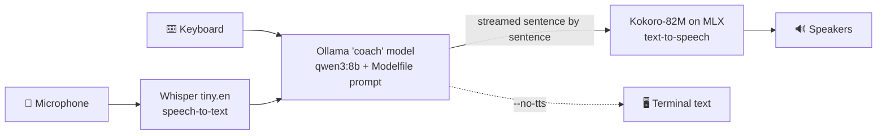

## Local Coach

A private, voice-driven personal coach that runs entirely on your Mac. You talk, it listens, and it talks back. Speech recognition, the language model and speech synthesis all run locally, so nothing you say leaves the machine.

> Forked from [vndee/local-talking-llm](https://github.com/vndee/local-talking-llm), which accompanies the article [Build your own voice assistant and run it locally](https://blog.duy-huynh.com/build-your-own-voice-assistant-and-run-it-locally/).

### How it works



1. At the prompt, either type a message or press Enter to start recording and Enter again to stop. [Whisper](https://github.com/openai/whisper) transcribes recordings.
2. The transcript and the conversation so far go to a local [Ollama](https://ollama.com) model through LangChain. The default `coach` model is `qwen3:8b` with the coaching system prompt and parameters defined in [`Modelfile`](Modelfile).
3. The reply streams back token by token. As each sentence completes, it is spoken by [Kokoro](https://huggingface.co/prince-canuma/Kokoro-82M) via [mlx-audio](https://github.com/Blaizzy/mlx-audio), so playback starts before the full reply has been generated. Markdown is stripped before speaking. With `--no-tts`, the reply is printed instead.

Conversation history is held in memory only and is gone when the app exits.

### Installation

Requires macOS on Apple Silicon (Kokoro runs on MLX), [uv](https://docs.astral.sh/uv/), and [Ollama](https://ollama.com). The project is pinned to Python 3.13 via `.python-version`; uv downloads it automatically if needed.

```bash
brew install uv ollama
ollama serve            # or launch the Ollama app; leave it running

git clone https://github.com/CrookedGrin/local-coach.git
cd local-coach

make setup
```

`make setup` runs `uv sync` and then [`scripts/download_models.py`](scripts/download_models.py), which downloads every model the app needs at runtime (about 5.5 GB in total):

| Model | Size | Cache location |
|---|---|---|
| Whisper `tiny.en` (speech-to-text) | ~75 MB | `~/.cache/whisper` |
| Kokoro-82M + voices (text-to-speech) | ~380 MB | `~/.cache/huggingface` |
| `qwen3:8b`, built into the `coach` model from `Modelfile` | ~5 GB | Ollama's model store |

> **Why a separate download step?** `app.py` sets `HF_HUB_OFFLINE=1` on every launch to skip Hugging Face's network check, so it cannot download Kokoro itself on a first run. If you skip `make setup`, the app fails with `LocalEntryNotFoundError`.

#### Using pip instead of uv

`requirements.txt` is exported from `uv.lock` and pins the same versions. Regenerate it after changing dependencies with:

```bash
uv export --format requirements-txt --no-hashes --no-emit-project --no-annotate -o requirements.txt
```

To install with pip:

```bash
python3.13 -m venv .venv
source .venv/bin/activate
pip install --ignore-requires-python -r requirements.txt
python scripts/download_models.py
```

`--ignore-requires-python` is needed because `misaki` 0.9.4 declares `Python <3.13` even though it works on 3.13. uv ignores such upper bounds; pip does not.

### Usage

```bash
uv run python app.py
```

Input and output are independent, so you can use any combination:

| You want | Run |
|---|---|
| Talk, hear replies | `uv run python app.py` |
| Type, hear replies | the same; type at the prompt instead of pressing Enter |
| Talk, read replies | `uv run python app.py --no-tts` |
| Type, read replies | `uv run python app.py --input text --no-tts` |

In the default voice mode you can mix typing and speaking turn by turn. `--input text` is keyboard only: it skips loading Whisper and never opens the microphone, so macOS won't ask for mic access. To make a combination your default, set `LOCAL_COACH_INPUT` and `LOCAL_COACH_TTS` (see [Configuration](#configuration)).

More options:

```bash
uv run python app.py --kokoro-voice af_heart --kokoro-speed 1.1   # different Kokoro voice
uv run python app.py --tts say --say-voice Samantha                  # macOS built-in TTS
uv run python app.py --no-tts                                        # text replies only
uv run python app.py --model qwen3:8b                                # skip the coach system prompt
uv run python app.py --debug                                         # per-stage timings
```

Press Ctrl+C (or Ctrl+D at the prompt) to quit.

### Configuration

Command-line flags:

- `--model`: Ollama model to use (default: `coach`, built from `Modelfile`)
- `--input`: `voice` (default; type a message or press Enter to record) or `text` (keyboard only, no Whisper or microphone)
- `--tts`: `kokoro` (default), `say` (macOS), or `none`; `--no-tts` is an alias for `none`
- `--kokoro-voice`: Kokoro voice id (default: `bf_emma`). The prefix sets the accent: `af_`/`am_` American, `bf_`/`bm_` British. The full list is in the [voices folder](https://huggingface.co/prince-canuma/Kokoro-82M/tree/main/voices).
- `--kokoro-speed`: Kokoro speed multiplier (default: `1.0`)
- `--say-voice`, `--say-rate`: voice and words-per-minute for `--tts say` (list voices with `say -v '?'`)
- `--debug`: print timing for each pipeline stage

Environment variables set your defaults; a command-line flag always overrides them. Export them in your shell profile (e.g. `~/.zshrc`); the app does not read a `.env` file.

| Variable | Default | Effect |
|---|---|---|
| `LOCAL_COACH_INPUT` | `voice` | Default for `--input` (`voice` or `text`) |
| `LOCAL_COACH_TTS` | `kokoro` | Default for `--tts` (`kokoro`, `say` or `none`) |
| `LOCAL_COACH_KOKORO_VOICE` | `bf_emma` | Default for `--kokoro-voice` |
| `LOCAL_COACH_HF_ONLINE` | unset | Set to `1` to allow Hugging Face network access, e.g. to pull a newer Kokoro revision |

#### Changing the coach's personality

The system prompt, base model and sampling parameters live in [`Modelfile`](Modelfile), not in Python. After editing it, rebuild the model:

```bash
ollama create coach -f Modelfile
```

To try a different base model, change the `FROM` line (for example `FROM gemma3:12b`) and rebuild; Ollama pulls the new base model automatically.

### Development

```bash
make test          # unit tests (no models or Ollama needed)
make lint          # every pre-commit hook: ruff, mypy, gitleaks, whitespace, pytest
```

Tests run locally rather than in CI, because they need the full ~1.6 GB Python environment. `make setup` installs a git pre-commit hook that runs ruff, mypy and the test suite on every commit touching Python files, and blocks the commit if any of them fail. If you cloned before this hook existed, install it with `uv run pre-commit install`.

### Troubleshooting

- **`LocalEntryNotFoundError` / "outgoing traffic has been disabled"**: a model or voice isn't cached. Run `make setup`, or run once with `LOCAL_COACH_HF_ONLINE=1`.
- **`ValueError: Model type kokoro not supported`**: mlx-audio hides the real import error behind this message. Run `uv run python -c "import mlx_audio.tts.models.kokoro"` to see the underlying error.
- **Connection refused on port 11434**: the Ollama server isn't running. Start it with `ollama serve` or open the Ollama app.
- **`model "coach" not found`**: run `ollama create coach -f Modelfile`.
- **"No audio recorded" or silent transcripts**: grant your terminal microphone access in System Settings → Privacy & Security → Microphone.
- **Building `tiktoken` asks for a Rust compiler**: you're on a Python version without prebuilt wheels. Use the pinned 3.13 (`uv python pin 3.13`, then `uv sync`).

### Resources

- [Kokoro-82M (MLX)](https://huggingface.co/prince-canuma/Kokoro-82M) and [mlx-audio](https://github.com/Blaizzy/mlx-audio)
- [Ollama](https://ollama.com) and the [Modelfile reference](https://github.com/ollama/ollama/blob/main/docs/modelfile.md)
- [Whisper](https://github.com/openai/whisper)
- [Original blog post](https://blog.duy-huynh.com/build-your-own-voice-assistant-and-run-it-locally/)
